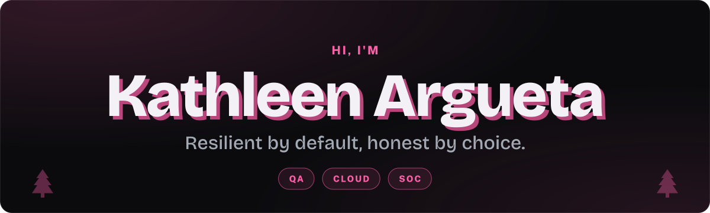
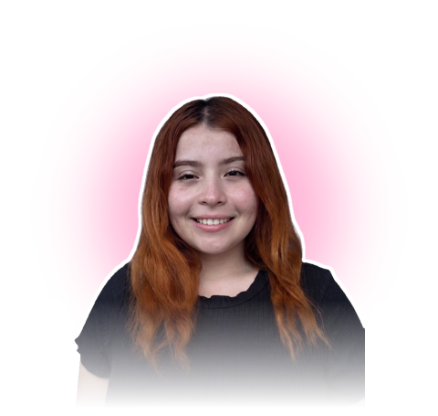
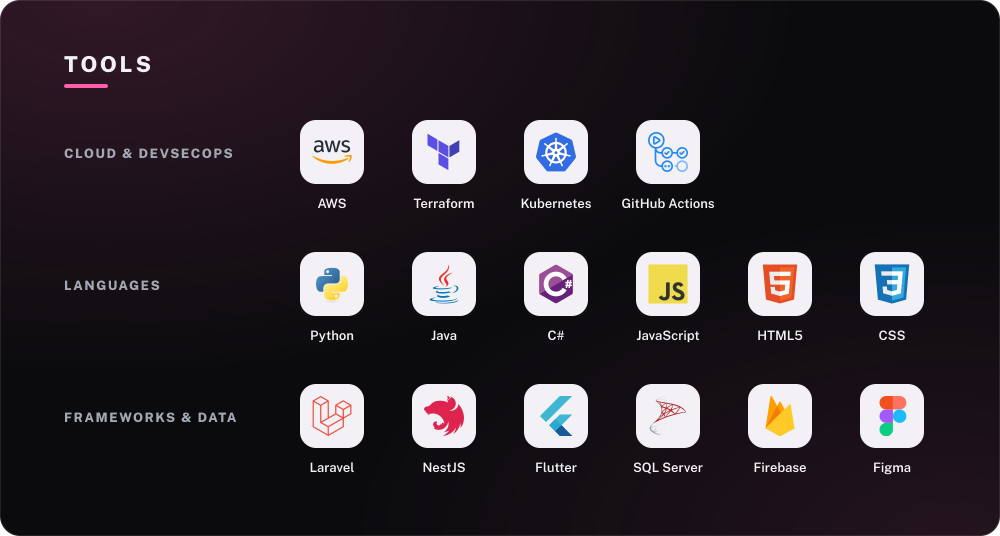
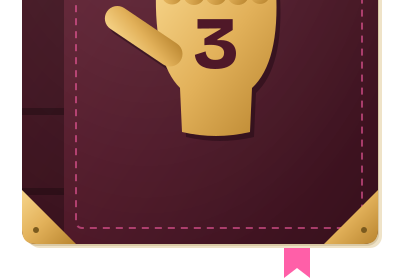

<div align="center">



<br>


<details>
<summary><b>Open the journal</b></summary>

<br>


<a href="https://kathleenargueta.github.io"></a>

<details>
<summary><b>About me</b></summary>

<div align="left">

```text
 PASS  tests/kathleen.spec.ts
  Kathleen Argueta
    ✓ studies Software Engineering & Digital Business at ESEN (3rd year)
    ✓ is looking for her first internship in QA, Cloud or SOC
    ✓ puts people first: asks why, standardizes the how, and keeps going
    ✓ led an internal system that took a manual process from 15 people to 5
    ✓ leads AIESEC at ESEN as Local Committee President
    ✓ is honest, resilient and curious
    ✓ still thinks Gravity Falls is the best cartoon ever made

 Tests:  7 passed, 7 total
 Time:   3 years and counting
```

</div>

</details>

<details>
<summary><b>Featured projects</b></summary>

<br>

| Project | Area | My part |
|---|---|---|
| [Legacy Delivery](https://github.com/KathleenArgueta/legacy-delivery-refactor) | Code quality | Refactor with SOLID, Strategy and Template Method, with a log for every decision |
| [CloudShop Enterprise](https://github.com/AlxMC2/CloudShop-Enterprise) | Cloud | Catalog module on AWS with Terraform: Lambda, DynamoDB and IAM |
| [DevSecOps Pipeline](https://github.com/Reina905/devsecops-pipeline-lab3) | SOC / DevSecOps | Dev environment in Terraform, Sonar and tests in a pipeline with CodeQL, Gitleaks and Trivy |
| [Fleet Management](https://github.com/TheAlejo999/backend-proyecto-catedra) | Access control | Roles, permissions and policies in Laravel |

</details>

<details>
<summary><b>Tools</b></summary>

<br>


</details>

<details>
<summary><b>My GitHub in numbers</b></summary>

<br>


<br>


</details>

<details>
<summary><b>Words to live by</b></summary>

<blockquote>
“…if you're curious, don't wait. Take a trip. Find it. It's out there, somewhere in the woods… waiting.”
<br><strong>Dipper Pines, Gravity Falls</strong>
</blockquote>

That's how I see learning: don't wait for the answer to find you. Go out, learn it, and turn it into a change people can see.

</details>

</details>



<br><br>

<picture>
  <source media="(prefers-color-scheme: dark)" srcset="https://raw.githubusercontent.com/KathleenArgueta/KathleenArgueta/output/snake-dark.svg" />
  <source media="(prefers-color-scheme: light)" srcset="https://raw.githubusercontent.com/KathleenArgueta/KathleenArgueta/output/snake-light.svg" />
  
</picture>

<br><br>

<a href="https://kathleenargueta.github.io"></a>
<a href="https://www.linkedin.com/in/kathleenargueta"></a>

<br><br>

<sub>Journal 3 drawn as fan art of Gravity Falls.</sub>

</div>
